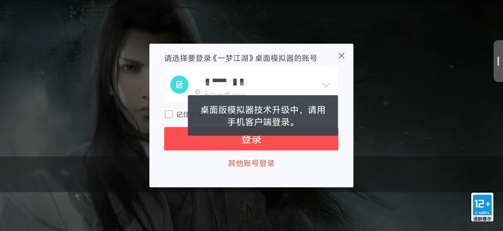
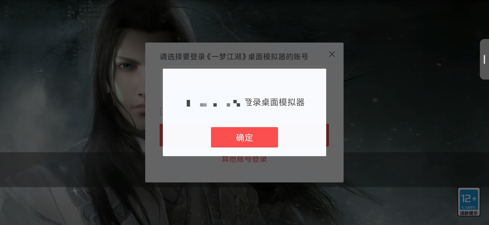
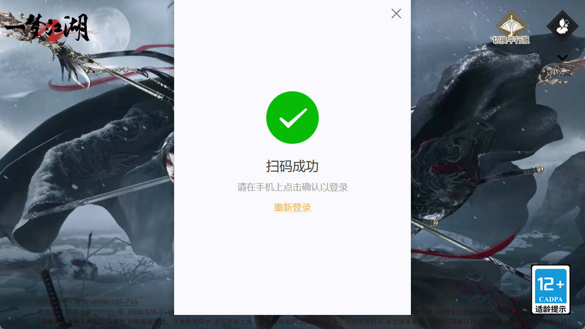

# 一梦江湖登录修复

这是一个 Windows 单文件批处理脚本，用于修复《一梦江湖》PC 端登录异常。

## 解决的问题

《一梦江湖》PC 端在每次大更新后，或者新账号首次登录时，可能会提示：

```text
桌面版模拟器技术升级中，请用手机客户端登录。
```

这种情况下，PC 端无法继续正常扫码登录。运行本脚本修复后，可以恢复到正常的扫码确认流程。

## 效果截图

修复前，PC 端登录时出现升级提示：



修复后，手机扫码时可以正常出现登录确认：



修复后，PC 端可以正常显示扫码成功：



## 文件

- `一梦江湖登录修复.cmd`
- `offline-package/Engine.zip`
- `offline-package/Engine/Binaries/Win32/netease.data`
- `offline-package/Engine/Binaries/Win64/netease.data`

## 离线说明

修复脚本是离线脚本，不依赖原始下载地址，也不会在运行时下载 `Engine.zip`。

脚本内已经嵌入同一份 `netease.data` 数据，运行时会先校验内嵌数据 SHA256，再写入游戏目录下的两个目标文件。

`offline-package/` 里同时保存了原始 `Engine.zip` 和解压后的两个 `netease.data` 文件，方便人工校验或手动替换。

为了保护历史来源域名和减少外部依赖，本仓库不公开记录原始获取地址。即使外部地址失效，脚本仍可离线替换。

## 游戏安装包

游戏安装包已单独放在腾讯微云：

```text
https://share.weiyun.com/B7zHWzWT
```

安装游戏后，再运行本仓库里的修复脚本。

## 使用

1. 先完全退出《一梦江湖》PC 端和启动器。
2. 下载本仓库里的 `一梦江湖登录修复.cmd`。
3. 右键 `一梦江湖登录修复.cmd`。
4. 选择“以管理员身份运行”。
5. 按提示确认或选择游戏目录。
6. 看到 `Done` 后重新启动游戏，再扫码登录。

脚本会先备份原文件，再替换：

- `Engine\Binaries\Win32\netease.data`
- `Engine\Binaries\Win64\netease.data`

## 系统兼容性

- 支持 Windows 10 和 Windows 11。
- 无需额外安装 PowerShell 7。脚本会优先使用已安装的 PowerShell 7；未安装时自动使用 Windows 自带的 Windows PowerShell 5.1。
- 如果系统中两者都不存在（通常只会出现在精简系统或系统组件被移除的情况），脚本会提示 `PowerShell was not found` 后退出，不会修改游戏文件。请在标准 Windows 环境中运行，或恢复 Windows PowerShell 组件。

## 使用记录和备份

每次运行脚本时，都会先把原文件备份到游戏目录下：

```text
_tmsoft_fix_backup\yyyyMMdd-HHmmss
```

例如脚本最后显示：

```text
Done. Backup: D:\wyclx\_tmsoft_fix_backup\20260720-160755
```

这个备份目录就是本次修复的使用记录。需要恢复时，可以从对应时间目录里找回原来的两个 `netease.data` 文件。

脚本不会上传用户电脑里的路径、账号或游戏文件。

## 目录识别

脚本会自动查找游戏目录：

- 支持中文用户名、中文路径、空格和特殊字符路径
- 支持通过桌面/开始菜单快捷方式反查安装目录
- 支持常见盘符根目录，例如 `D:\wyclx`
- 如果只找到一个目录，会让用户确认
- 如果找到多个目录，会显示编号让用户选择
- 如果没有找到，可以手动粘贴游戏目录

判断标准不是目录名，而是目录下必须存在两个目标文件：

- `Engine\Binaries\Win32\netease.data`
- `Engine\Binaries\Win64\netease.data`

## 校验

脚本 SHA256：

```text
199AD5570E5560247E6AF513C1F1EFF6BE59AB38494DA8E86202CDD5D25F73FB
```

替换后的 `netease.data` SHA256：

```text
535854FB2ABE71E16F645A879F1C00144FD9BA71548DE44B8E51E049BEAD2D87
```
